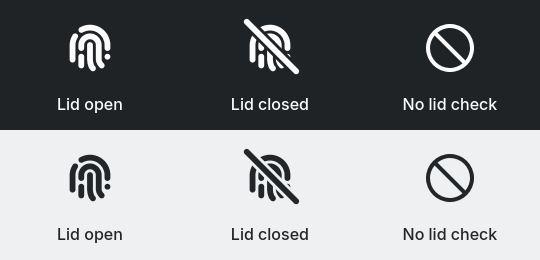

# lid-fingerprint

Use the fingerprint reader for sudo, polkit and the lock screen on Fedora KDE, but only while the laptop lid is open. If the lid is closed, for example with an external monitor, the prompt asks for the password at once instead of waiting for a finger you cannot reach.

A tray icon shows the current state:



| Icon | Meaning |
|---|---|
| Fingerprint | Lid open. sudo and the lock screen accept the fingerprint. |
| Fingerprint with a slash | Lid closed. Password only. |
| Circle with a slash | PAM has no lid check, for example after another authselect change. Run `sudo ./pam-setup install` again. |

## Requirements

- Fedora KDE with authselect (the Fedora default)
- A fingerprint reader that `fprintd` supports, with a finger enrolled (`fprintd-enroll`)
- `fprintd-pam` and `python3-pyqt6`:

```
sudo dnf install fprintd-pam python3-pyqt6
```

## Install

```
git clone https://github.com/rodbv/lid-fingerprint.git
cd lid-fingerprint
./install.sh
```

`install.sh` asks for your password once, to change the PAM configuration. The change lives in `/etc/authselect` and the tray icon starts from `~/.config/autostart`, so both stay after a reboot.

## Check that it works

- `fprintd-verify` reads your finger directly, without sudo or PAM.
- With the lid open, `sudo -k; sudo true` asks for your finger.
- With the lid closed, `sudo -k; sudo true` asks for your password.
- `authselect current` shows `custom/lid-fingerprint` with `with-fingerprint`.

## How it works

`pam-setup install` copies your current authselect profile (usually `local`) to `custom/lid-fingerprint`, adds one line before each `pam_fprintd.so` line, and selects the new profile with your current features plus `with-fingerprint`. The added line runs `pam_exec` with `grep -q open /proc/acpi/button/lid/<LID>/state`:

- `system-auth` (sudo, polkit, login): if the lid is closed, PAM skips the `pam_fprintd` line and continues to the password.
- `fingerprint-auth` (the KDE lock screen fingerprint path): if the lid is closed, PAM fails this path at once. The password field of the lock screen keeps working.

The tray icon reads the lid state and `/etc/pam.d/system-auth` every 2 seconds. It shows whether the lid check is in place and what the lid state is. It does not test the reader itself; use `fprintd-verify` for that.

## Uninstall

```
./uninstall.sh
```

`uninstall.sh` removes the tray icon and selects your earlier base profile with the same features, without `with-fingerprint`. To keep the fingerprint on with the lid closed too, run `sudo authselect enable-feature with-fingerprint`.

The first install also saves an authselect backup named `before-lid-fingerprint-<date>`. `sudo authselect backup-list` lists it, and `sudo authselect backup-restore <name>` restores it.

## Limitations

- Fedora KDE only. The PAM part needs authselect, and the tray icon expects a StatusNotifierItem tray such as the Plasma panel.
- If your system already uses a custom authselect profile, `pam-setup install` stops. Add the two lines from `pam-setup` to your profile by hand.
- If the machine has no lid in `/proc/acpi/button/lid`, `pam-setup install` stops.

## License

GPL-3.0-or-later. The fingerprint icons derive from the [Papirus icon theme](https://github.com/PapirusDevelopmentTeam/papirus-icon-theme) (GPL-3.0), and the PAM test fixtures come from [authselect](https://github.com/authselect/authselect) (GPL-3.0).
